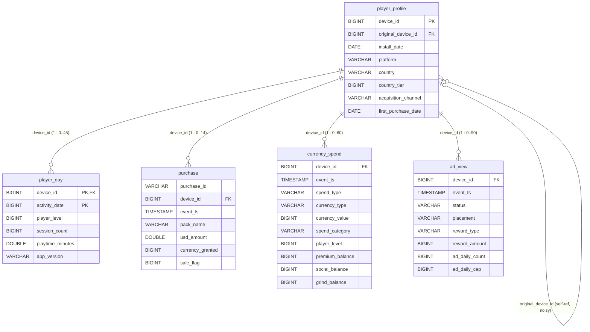

# Phase 1: Table Relationships & Schema Design

This document explains how the five tables relate to one another, which columns act as primary and foreign keys, and how to join them safely without multiplying rows.

---

## 1. Entity-Relationship Diagram

---

## 2. Primary Keys & Uniqueness Analysis

| Table | Candidate Primary Key | Unique? | Notes |
| --- | --- | --- | --- |
| `player_profile` | `device_id` | **Yes** (80,295 / 80,295) | Clean single-column Primary Key |
| `player_day` | `(device_id, activity_date)` | **Yes** (667,435 / 667,435) | Clean composite Primary Key |
| `purchase` | `purchase_id` *(expected)* | **No** (122 duplicates) | `purchase_id` repeats 122 times with different `event_ts`; `(purchase_id, event_ts)` and `(device_id, event_ts)` are unique |
| `currency_spend` | None (single column) | **No** (`(device_id, event_ts)` has 110 duplicates) | `(device_id, event_ts, currency_type, currency_value, spend_category)` is unique across all 489,892 rows |
| `ad_view` | None (single column) | **No** (`(device_id, event_ts, status, placement)` has 32 duplicates) | Requires a synthetic surrogate key (e.g. `ROW_NUMBER()`) or deduplication for exact row identity |

---

## 3. Foreign Keys & Referential Integrity

### 3.1 Child Tables -> `player_profile`
Every `device_id` in all four event/daily tables exists in `player_profile`:

| Child Table | Child Rows | Distinct `device_id`s | Orphan Rows | Profile `device_id`s Absent from Child Table |
| --- | ---: | ---: | ---: | ---: |
| `player_day` | 667,435 | 79,181 | **0** | 1,114 (1.39%) |
| `purchase` | 15,426 | 11,054 | **0** | 69,241 (86.23%) |
| `currency_spend` | 489,892 | 73,216 | **0** | 7,079 (8.82%) |
| `ad_view` | 647,623 | 74,042 | **0** | 6,253 (7.79%) |

### 3.2 Cross-Table Date Alignment (`event_ts` vs `player_day.activity_date`)
- **`currency_spend` -> `player_day`:** **489,892 / 489,892 (100.00%)** match `(device_id, activity_date)` when converting `event_ts` to `YYYYMMDD`.
- **`ad_view` -> `player_day`:**
  - Raw `DATE(event_ts)`: only **316,957 / 647,623 (48.94%)** match.
  - Adjusted `DATE(event_ts - INTERVAL 8 HOUR)`: **647,623 / 647,623 (100.00%)** match!
- **`purchase` -> `player_day`:**
  - **12,763 / 15,426 (82.74%)** match `(device_id, activity_date)` on the exact calendar date.
  - **2,663 / 15,426 (17.26%)** occur on a date with no `player_day` row for that player (even though all 2,663 devices appear in `player_day` on other dates). Therefore, daily revenue queries must **not** `INNER JOIN` `purchase` to `player_day`.

---

## 4. Cardinality & Join Multiplication Warning (For Beginners)

All four child tables have a **one-to-many (`1 : N`)** relationship with `player_profile`:
- `player_day`: 1 to 45 rows per active device (median 7)
- `purchase`: 1 to 14 rows per paying device (median 1)
- `currency_spend`: 1 to 60 rows per spending device (median 5)
- `ad_view`: 1 to 90 rows per ad-watching device (median 6)

> **Important SQL Rule — Never join two child tables directly on `device_id`!**  
> If a player has 10 rows in `player_day` and 3 rows in `purchase`, joining `player_day` directly to `purchase` on `device_id` creates `10 × 3 = 30` rows for that player — tripling their revenue if you run `SUM(usd_amount)`!  
> **Safe pattern:** Always aggregate each child table to the desired grain first (e.g., per `device_id`, or per `(device_id, date)`) in a CTE (`WITH ... AS (...)`) before joining tables together.

---

## 5. Investigation of `original_device_id`

- **3,211 rows** in `player_profile` point to an `original_device_id` (all 3,211 exist in `player_profile.device_id`, and no two rows point to the same `original_device_id`).
- **Structural anomalies found:**
  - `1` self-referencing loop (`125989 -> 125989`)
  - `112` multi-step chains (`A -> B -> C`)
  - `1,584` pairs where `new.install_date < old.install_date`
  - `1,425` pairs active on the exact same day in `player_day`
  - `3,025` pairs (94.21%) have **different countries** (`only 186 match`), `1,348` (41.98%) have **different platforms**, and `2,114` (65.84%) have **different acquisition channels**.
- **Recommendation for Phase 2+:** Keep `device_id` as the canonical player key for primary metrics, and explicitly document why `original_device_id` cannot be safely used for deterministic player merging without corroborating attributes.
